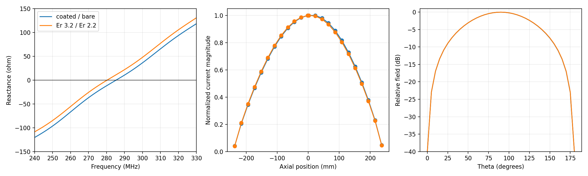

# Coated-wire M6 junction results

Status: accepted by the user on 2026-11-06.

## Outcome

M6 supports a physical junction between wire tags when every coating property
is exactly equal: conductor radius, coating radius, relative permittivity, loss
tangent, and conductivity. Splitting one uniform conductor into tags is only a
geometry-authoring choice and does not introduce a dielectric transition.

Coated-to-bare and unequal-coating contacts remain errors by default. The
present coating correction is selected by the *source* segment. At a material
transition it omits the transition/end polarization basis needed to make the
operator reciprocal. Relaxing the parser would therefore produce a plausible
but physically inconsistent answer.

An explicit research escape hatch is available:

```text
--coated-wire-junctions experimental
```

It stamps the machine result with `operator_status: experimental-junction` and
a `COATED_WIRE_EXPERIMENTAL_JUNCTION` warning. It is intended to measure future
formulations, not to authorize production use.

## Identical-coating promotion

The test article is a 0.48 m straight dipole represented either by one 96
segment tag or by two connected 48 segment tags. The two-tag article uses an
independent `LD 7` card on each tag. Lossless and lossy sweeps exercise current,
input impedance, dielectric absorption, radiation, and power balance.

| Metric | Result | Gate |
| --- | ---: | ---: |
| Maximum lossless solution delta | `4.138e-10` relative | `< 1e-8` |
| Maximum lossy solution delta | `4.215e-10` relative | `< 1e-8` |
| Maximum lossless power delta | `4.462e-10` relative | `< 1e-5` |
| Maximum lossy power delta | `1.420e-6` relative | `< 1e-5` |
| Reciprocity defect | `2.651e-13` relative | `< 1e-12` |

The small nonzero tag-split deltas come from NEC geometry regeneration at the
two `GW` boundaries; they are far below the numerical acceptance budget. The
single- and two-tag matrices have the same order.

## Rejected transition candidates

The research switch was used to apply the existing source-domain correction
without a transition basis. Its transfer-current reciprocity defects are:

| Candidate | Reciprocity defect | M3 gate |
| --- | ---: | ---: |
| Coated/bare contact | `1.816e-2` | `1e-12` |
| Er 3.2, 4 mm / Er 2.2, 3 mm contact | `6.967e-3` | `1e-12` |

These failures are structural, not convergence noise. They are respectively
about 18 billion and 7 billion times the accepted reciprocity limit. Both
topologies must remain rejected until a coating-transition charge/current basis
is derived and validated.

## Independent asymmetric references

Two cylindrical, axisymmetric OpenEMS articles use the accepted 2 mm physical
feed gap, 0.5 mm axial mesh, four or more radial coating cells, 8 angular cells,
512-sample axisymmetric far-field reconstruction, and a `1e-4` transient energy
criterion. Probe planes are snapped to the 0.5 mm antenna lattice; the final
meshes contain no axial sliver cells.

| Article, positive / negative arm | Resonance | Resistance | Current mirror delta | Directivity |
| --- | ---: | ---: | ---: | ---: |
| Er 3.2, 4 mm / bare | 285.381901 MHz | 71.594641 ohm | 4.675% | 2.159343 dBi |
| Er 3.2, 4 mm / Er 2.2, 3 mm | 280.349056 MHz | 68.552087 ohm | 2.693% | 2.168034 dBi |

The full-wave articles confirm that the requested asymmetric antennas are
well-defined and remain rotationally symmetric; the NF2FF azimuthal residual is
below `6e-8`. They are now frozen targets for a future transition formulation.

The invalid NEC candidate happens to place resonance within 0.27% and 0.53% of
these references, but misses resistance by 8.12 ohm and 3.96 ohm and is
nonreciprocal. This is a useful warning: resonance alone would have made the
wrong operator look convincing.



## Supported topology matrix

| Topology | Default behavior | Rationale |
| --- | --- | --- |
| Continuous wire, one coated tag | Supported | Accepted in M3--M5. |
| Connected tags, identical coating | Supported | M6 representation identity, reciprocity, and power gates pass. |
| Coated-to-bare physical contact | Error | Missing transition polarization; reciprocity and resistance gates fail. |
| Connected unequal coatings | Error | Missing transition polarization; reciprocity and resistance gates fail. |
| Coated and bare/differently coated feed arms separated by a physical gap | OpenEMS validation target only | NEC has no accepted two-terminal coated-wire transition/feed basis yet. |
| Coated wire to patch or ground | Error | Still outside the validated operator. |

## User acceptance

Run the deterministic suite:

```sh
python3 tests/coated-wire/m6_junctions.py
```

Run and inspect the promoted two-tag article:

```sh
./nec2c --result-json /tmp/m6-uniform.json \
  -i tests/coated-wire/m6-uniform-junction.nec \
  -o /tmp/m6-uniform.out
```

Confirm the default safety gate, then inspect the explicitly warned research
result:

```sh
./nec2c --result-json /tmp/m6-strict.json \
  -i tests/coated-wire/m6-coated-bare-experimental.nec \
  -o /tmp/m6-strict.out

./nec2c --coated-wire-junctions experimental \
  --result-json /tmp/m6-experimental.json \
  -i tests/coated-wire/m6-coated-bare-experimental.nec \
  -o /tmp/m6-experimental.out
```

Acceptance asks for approval of both the topology matrix and whether the
research-only CLI escape hatch should remain available. M7 must not begin until
the user records PASS or requests changes.
