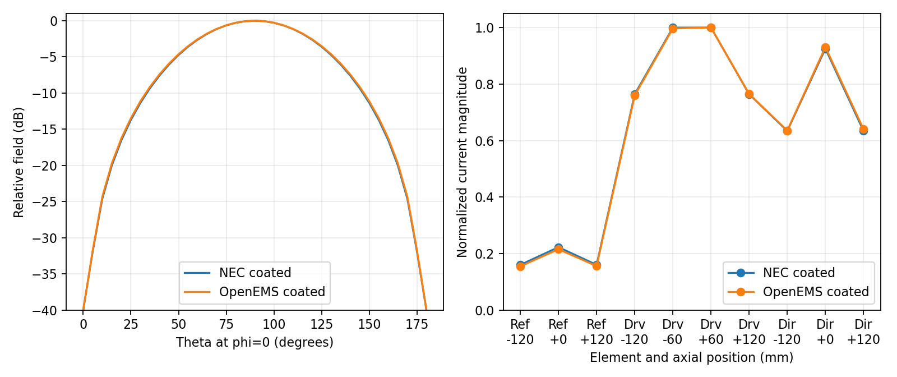

# Coated-wire M7 general-geometry results

Status: accepted; qualified bend policy implemented.

## Outcome

M7 does not promote unrestricted general coated-wire geometry. It establishes
a reproducible research path for multiple disconnected, straight, uniformly
coated elements and validates a conservative connected-bend envelope. The
multi-element witness is a three-element Yagi; the bend witness is a constant-
length planar Z independently compared with MATLAB and OpenEMS. The coating
correction retains NEC's existing current basis and matrix order.

Default behavior supports one continuous, uniformly coated open wire,
including collinear equal-coated tag splits and bends inside the qualified
45-degree/four-radius envelope. Disconnected elements, tighter bends, loops
and general 3-D forms require
`--coated-wire-junctions experimental` and are stamped
`experimental-geometry`.

Axis-aligning a 90-degree bend with the Cartesian OpenEMS grid removed
diagonal-cylinder staircasing. A later fine-grid and MATLAB audit showed that
the original bare NEC/OpenEMS miss was dominated by FDTD resolution. A matched
bare/coated audit of a 45-degree, 5.657-coating-radius chamfer then reproduced
NEC's coating shift within 0.354 percentage point. Strict mode reports
`COATED_WIRE_BEND_UNVALIDATED` only outside the qualified envelope; other
unvalidated general geometry reports
`COATED_WIRE_GENERAL_GEOMETRY_UNVALIDATED`.

## Independent Cartesian reference

The research article uses three parallel, axis-aligned PEC cylinders:

| Element | X position | Length | Metal radius | Coating radius |
| --- | ---: | ---: | ---: | ---: |
| Reflector | -120 mm | 490 mm | 2 mm | 4 mm |
| Driven | 0 mm | 450 mm, less a 2 mm feed gap | 2 mm | 4 mm |
| Director | +110 mm | 430 mm | 2 mm | 4 mm |

The coating has relative permittivity 3.2 and zero loss.  OpenEMS uses true
cylinders with flat flush end faces, a Cartesian mesh, a symmetric terminal
current contour, a 240--360 MHz sweep and an exact `1e-4` transient-energy
criterion. The retained references use 2 mm and 1 mm isotropic meshes plus a
targeted bare mesh with 0.5 mm transverse and 1 mm axial pitch. The latter has
27.18 million cells, ran for 88.9 minutes, and provides four transverse cells
through the prospective coating thickness. Sixteen workers leave headroom on
the 32-logical-CPU validation host.

## NEC/OpenEMS comparison

The versioned machine record is `tests/coated-wire/m7-acceptance.json`; it
contains the impedance sweeps, normalized pattern and sampled currents, mesh
statistics, runtimes and convergence deltas. M7 applies the M3/M4 1% resonance
and 2 ohm resistance budget. The absolute resonance gate cannot be evaluated
because the *bare* Cartesian reference itself does not converge:

| Bare OpenEMS mesh | Resonance | Resistance | Change from preceding mesh |
| --- | ---: | ---: | ---: |
| 2 mm isotropic | 315.836559 MHz | 13.275886 ohm | -- |
| 1 mm isotropic | 306.888656 MHz | 13.232875 ohm | -2.916% |
| 0.5 mm transverse, 1 mm axial | 311.517851 MHz | 13.573380 ohm | +1.486% |

The non-monotonic final change remains above 1%. An isotropic 0.5 mm model
would require about 50 million cells, while another transverse refinement
would exceed the agreed two-hour point budget. No absolute multi-element
promotion claim is made.

The matched 1 mm bare/coated pair still provides useful differential evidence:

| Quantity | NEC | OpenEMS | Difference |
| --- | ---: | ---: | ---: |
| Bare resonance | 316.361059 MHz | 306.888656 MHz | +3.0866% absolute |
| Coated resonance | 293.968501 MHz | 286.618885 MHz | +2.5642% absolute |
| Coating-induced resonance shift | -7.0782% | -6.6049% | -0.4732 percentage point |
| Coating-induced resistance change | -1.228662 ohm | -1.051329 ohm | -0.177333 ohm |
| Coated directivity | 7.842915 dBi | 7.746516 dBi | +0.096399 dB |
| Maximum pattern error above -40 dB | -- | -- | 0.290834 dB |
| Maximum normalized-current delta | -- | -- | 0.007204 |

These differential results are encouraging and meet their numerical budgets,
but they do not override the failed absolute reference-convergence gate.



## Qualified bend envelope

A straight 474 mm Cartesian control reproduced the expected half-wave result:
295.844776 MHz and 71.813040 ohms.  That qualified the feed, terminal-current
measurement, sweep and far-field processing before testing bends.

The diagnostic bend consists only of Cartesian-axis-aligned cylinders:
187 mm vertical, 100 mm horizontal and 187 mm vertical, with two 90-degree
junctions.  The original 2 mm OpenEMS mesh found the bare resonance at
287.919201 MHz and 42.726677 ohms, while the NEC representation found about
319 MHz and 49 ohms.  M7 initially treated the 10.85% resonance discrepancy as
a classic thin-wire sharp-junction limitation.

The bend-envelope addendum disproved that attribution.  OpenEMS moved to
308.703591 MHz/46.630508 ohms at 1 mm and 313.372852 MHz/47.795678 ohms at
0.5 mm transverse by 1 mm axial resolution.  An independent MATLAB Antenna
Toolbox surface-MoM model found 317.685 MHz/49.497 ohms, within 0.432% and
0.527 ohm of NEC.  Thus the original 10.85% result was dominated by Cartesian
FDTD resolution, not evidence that NEC intrinsically fails at the sharp bend.

The addendum next tested a constant-length battery with 1, 2, 3, 4 and 6 chords
per 90-degree corner and bend radii from 1 to 12 outer coating radii. Across
nine representative bare cases, NEC and MATLAB differ by at most 0.432% in
resonance and 0.527 ohm in resistance. Across the ten cases meeting the proposed
`X=45 degrees, Y=4 radii` rule, NEC's coating-induced resonance shift varies
only from -6.596% to -6.521%.

For the rule's one-chord `R/b=4` boundary, a 61.85-million-cell bare OpenEMS
run converged to 306.377 MHz/51.553 ohms, within 1.74% and 2.73% of NEC. At the
finest matched 1 mm bare/coated grid, OpenEMS predicts a -6.242% resonance
shift versus -6.596% in NEC, only 0.354 percentage point apart. This supports
the proposed rule as a conservative engineering envelope, but not arbitrary
coated bends. Full methods and retained evidence are in
`COATED-WIRE-M7-BEND-ENVELOPE.md`.

Diagonal and shallow-angle experiments were also rejected: changing the
Cartesian representation moved resonance materially while the straight
control remained stable.  They remain useful diagnostics, but are not evidence
for production support.

## Deterministic solver gates

`tests/coated-wire/m7_geometry.py` verifies:

* the Er=1 null limit for a bent research article;
* backend and thread-count invariance;
* reciprocity relative to the corresponding bare NEC discretization;
* positive dielectric absorption and less than 0.3% power-balance defect for
  lossy bend and disconnected-element articles;
* segmentation convergence of the experimental bend;
* normal execution of disconnected, Yagi, loop and three-dimensional cases;
  and
* strict rejection of a non-collinear coated junction.

The exact disconnected pair has zero measured reciprocity defect.  The Yagi's
coated defect is `8.054e-6`, slightly smaller than its bare NEC reference
defect of `9.411e-6`.  Experimental bend, loop and 3-D defects are required not
to materially enlarge their corresponding bare discretization defects.  Lossy
power-balance defects are 0.2027% for the bend and 0.0107% for the disconnected
pair.

## Supported topology matrix

| Topology | Default behavior | M7 evidence |
| --- | --- | --- |
| One straight coated wire | Supported | Accepted in M3--M5. |
| Connected collinear tags with exactly equal coating | Supported | M6 representation identity. |
| Multiple disconnected straight elements with exactly equal coating | Error by default; experimental opt-in | Differential Yagi evidence is good, but bare Cartesian absolute resonance failed convergence. |
| Non-collinear connected coated wires within `X=45, Y=4` | Supported | Fine bare OpenEMS, MATLAB, and matched coating-shift evidence meet the relaxed high-confidence bands. |
| Tighter non-collinear coated wires | Error | Outside the validated engineering envelope; research switch only. |
| Closed coated loop or connected 3-D wire | Error | Algebraic checks pass under the research switch, but physical validation has not. |
| Coated-to-bare or unequal-coating contact | Error | M6 transition basis remains unresolved. |
| Coated wire to patch or ground | Error | Outside the validated operator. |

All wire segments in a strict coated-wire job must currently be coated and use
identical coating properties.  This intentionally excludes mixed disconnected
materials until the source-domain formulation and its reciprocity implications
are validated.

## Reproduction and acceptance

Run the deterministic suite:

```sh
python3 tests/coated-wire/m7_geometry.py
```

Run the experimental multi-element witness:

```sh
./nec2c --coated-wire-junctions experimental \
  --result-json /tmp/m7-yagi.json \
  -i tests/coated-wire/m7-coated-yagi.nec \
  -o /tmp/m7-yagi.out
```

The research-only bend requires an explicit opt-in:

```sh
./nec2c --coated-wire-junctions experimental \
  --result-json /tmp/m7-bend.json \
  -i tests/coated-wire/m7-coated-v.nec \
  -o /tmp/m7-bend.out
```

The user accepted the qualified bend evidence and requested implementation of
the `X=45, Y=4` default policy. The disconnected Yagi remains experimental
because its absolute Cartesian reference did not converge within budget.
