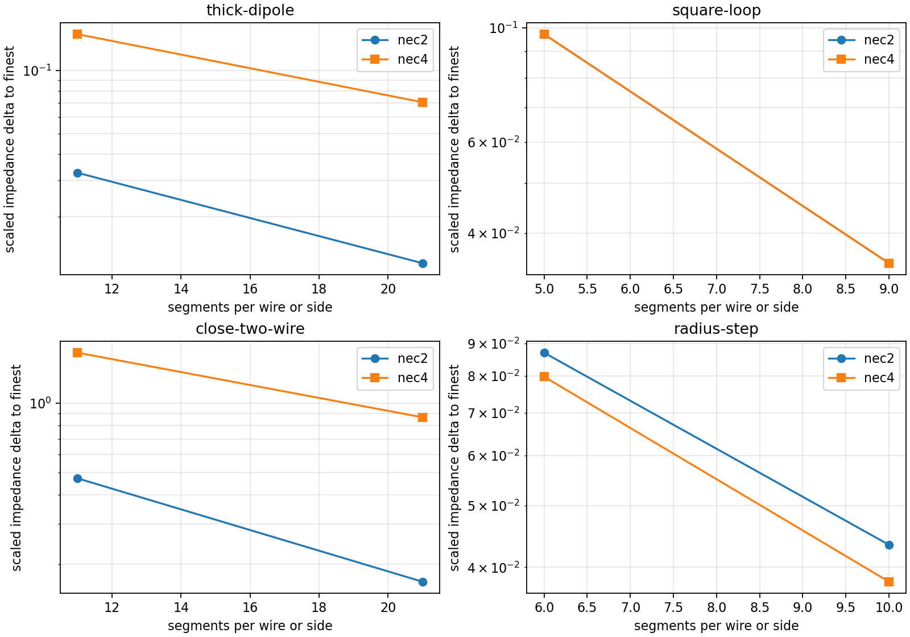

# NEC4 similarity M4: reduced thin-wire kernel

Status: implementation complete; awaiting user acceptance.

## Outcome

M4 adds the documented NEC4 reduced thin-wire interaction to the opt-in
`--wire-engine nec4` path.  The source current is placed on the source
cylinder, the boundary condition is matched on the observation axis, and the
operator evaluates the five Appendix B field components for sine, constant,
and cosine-minus-constant current.  The classic and `auto` paths remain NEC2.

This is deliberately not yet a complete NEC4 free-space engine.  Open wire
ends, voltage-source gaps, and load gaps still lack the end-cap terms assigned
to M5.  The M4 refinement data makes that boundary visible rather than hiding
it.

## Mathematical provenance and implementation

The implementation in `nec4_kernel.c` follows Appendix B equations B-1
through B-24 and the Appendix C scalar-potential integral construction in the
public NEC-4 theory guide.  It does not use a licensed executable, source, or
empirically extracted NEC-4 constant.

The production evaluator contains these branches:

- exact reduced field;
- near-axis radial continuation;
- small-`kR` expansion;
- combined small-`kR`/near-axis continuation;
- far-distance expansion; and
- combined far-distance/small-`kR` expansion.

The guide's single-precision switches were not copied.  Double-precision error
maps selected these production thresholds:

| Switch | Production threshold |
| --- | ---: |
| Far-distance ratio `R0/delta` | `1e6` |
| Small-`kR` | `0.0001 * 2*pi` |
| Near-axis ratio | `0.001` |
| Small-`kR` near-axis ratio | `0.005` |

The cancellation-prone direct radial calculation uses extended-precision
intermediates.  Inside the axial branch, the published limit is continued as
an even polynomial in radial distance using two safe auxiliary evaluations.
This creates an overlap where both representations satisfy the M1 accuracy
contract.

The scalar integral uses a converged, shifted Appendix C moment series when
`k*delta <= 1` and the observation is within ten half-segment lengths.  Smooth
distant interactions use six-point Gaussian quadrature; other cases use an
adaptive 16-point rule.  A rejected prototype that copied the five-term
single-precision series missed ordinary fields by approximately `1e-6`.

## Independent numerical validation

`tests/nec4-similarity/m4_kernel.py` evaluates the production C code against
an independent 80-decimal-place `mpmath` integration of the exact B-1 through
B-5 field.  It covers every limiting branch, both sides of every production
switch, the converged series, and adaptive quadrature.

| Measurement | Maximum scaled error |
| --- | ---: |
| Six representative production branches | `5.478e-13` |
| All branch-switch boundaries | `7.652e-12` |
| Shifted moment series cases | `1.259e-14` |
| Distant six-point quadrature case | `1.536e-12` |
| Adaptive quadrature cases | `3.634e-16` |

All results meet the M1 `1e-11` element-field contract.  Constant-current
radial field is exactly zero by construction, as required by the reduced
operator.

## Antenna-level characterization

The retained corpus covers a thick dipole, closed square loop, close parallel
two-wire structure, and unequal-radius step.  Each uses three refinements and
records NEC2 and NEC4 complex feed impedance.  Serial and four-thread NEC4
results have a maximum scaled numerical delta of exactly zero.

The square loop and radius-step cases have smooth monotonic refinement.  The
NEC4 radius-step error to the finest tested mesh is `0.0798` then `0.0380`,
slightly below NEC2's `0.0871` then `0.0434`.  The closed square-loop curves
are nearly coincident, which is expected for a thin, well-behaved closed
structure.

The open thick dipole and close two-wire feed case show larger NEC4 movement
under refinement.  For example, the dipole changes from
`87.108 + j34.132 ohm` at 11 segments to `98.397 + j45.771 ohm` at 31
segments.  This is the documented open-cylinder/source-gap pathology: M4 has
removed the artificial endpoint point-charge field, but M5 has not yet closed
the conductor with end and source caps.  These cases are retained as the
before-M5 benchmark.



## Validity diagnostics

NEC4 reports, for each prepared geometry:

- the minimum segment-length/radius ratio;
- segments below `L/a = 2`;
- closely spaced, axially overlapping parallel-wire pairs;
- observation match points buried inside another wire cylinder; and
- overlapping connected bends.

`--model-check warn` prints and continues.  `strict` rejects a model containing
any of these conditions, and `off` suppresses the report.  The acceptance
fixture verifies that all 61 segments of a deliberately over-refined thick
dipole are reported below `L/a = 2` at a minimum ratio of `1.57377`, and that
strict mode rejects it.

These diagnostics identify conditions documented as problematic; they do not
claim that every warning implies a quantitatively unusable result.

## Compatibility, performance, and validation

- `--wire-engine auto` and `nec2` remain bit-preserving classic paths.
- No NEC card syntax or result JSON field changed.
- The optimized suite passes 54/54 with no skips or failures.
- ASan/UBSan passes the M4 kernel oracle and complete M4 model corpus;
  LeakSanitizer is disabled because it is unavailable under the app host.
- The 401-segment, nine-frequency real-ground fixture takes about `0.88 s`
  with the NEC2 operator and `1.81 s` with the richer NEC4 operator at one
  thread.  Existing fill parallelism reduces NEC4 to about `0.57 s` at 16
  threads.
- A representative NEC4 run uses `9,472 KiB` peak RSS.

The roughly 2.1x serial operator cost is measured and explained, not an
unaccounted regression.  Further optimization is allowed, but no approximation
that failed the M1 field tolerance was retained.

Retained evidence:

- `tests/nec4-similarity/m4-acceptance.json`
- `tests/nec4-similarity/m4-model-convergence.png`
- `tests/nec4-similarity/m4_kernel.py`
- `tests/nec4-similarity/m4_models.py`
- `tests/nec4_kernel_test.c`

No additional software or library is required.

## Manual acceptance

From the repository root:

```sh
make tests/nec4_kernel_test
python3 tests/nec4-similarity/m4_kernel.py
python3 tests/nec4-similarity/m4_models.py
```

The first script should finish with:

```text
M4 worst switch-boundary error 7.652e-12
```

The second should finish with:

```text
M4 serial/parallel maximum scaled delta 0.000e+00
M4 antenna convergence corpus and deterministic fill passed
```

For user review, the most important artifact is the convergence figure.  The
open-wire separation between NEC2 and M4 is expected at this stage; acceptance
means approving the reduced kernel and its explicit M5 cap boundary, not
claiming that the open-wire result is already release-ready.
